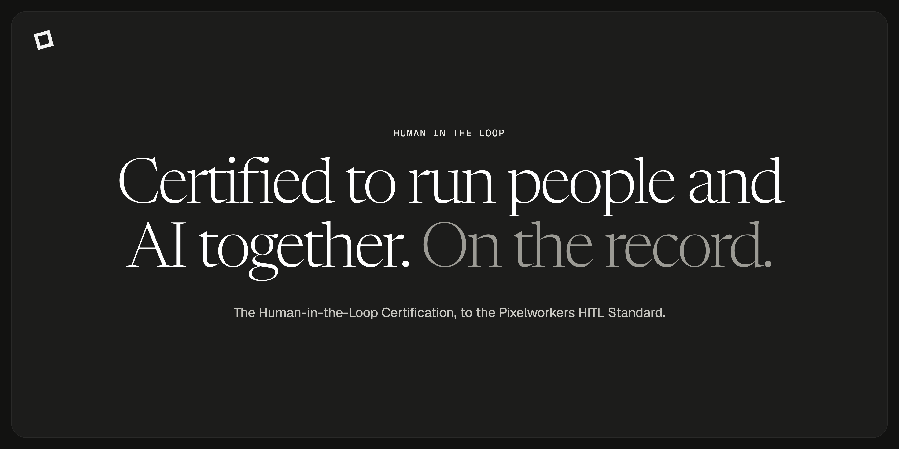

Pixelworkers is a design and engineering studio. Every job is done by a named person and a named AI operator working the same problem together, and a person approves everything before it ships.

## The HITL Certification

A certification for designers, developers and marketers who want to work the way we do: a person and an AI operator on the same job, on the record. You get your own copy of the setup we use, you use it on real work, and then you walk us through that work live.

These repositories are previews of what's included:

- [operator](https://github.com/pixelworkers/operator): Your named AI partner. You work the same problem together.
- [hub](https://github.com/pixelworkers/hub): Securely connects your operator to any tool you use.
- [kb-template](https://github.com/pixelworkers/kb-template): A folder structure for client notes, brand rules and a log of changes.
- [bootstrap](https://github.com/pixelworkers/bootstrap): A setup script that installs and connects everything on your computer.

Early access opens December 1. [Sign up at pixelworkers.org/certifications](https://pixelworkers.org/certifications)

## The studio

Tell us what you need at [pixelworkers.org](https://pixelworkers.org).
